<p align="center">
  
</p>

<h1 align="center">Quasar — FTC #19097</h1>

<p align="center">
  Site-ul echipei de robotică Quasar din Huși, Vaslui.<br />
  <a href="https://quasarftc.com"><strong>quasarftc.com</strong></a>
</p>

<p align="center">
  <strong>Română</strong> · <a href="README.en.md">English</a>
</p>

<p align="center">
  
  
  
  
</p>

---

Am vrut un site care să nu arate ca un template de școală. Așa că e o singură scenă 3D prin care camera
se plimbă de la stânga la dreapta, iar fiecare oprire e un „capitol”: robotul, premiile, echipa,
outreach, sponsorii, donații și contact. Totul are un HUD de cameră video peste, cu REC, timecode și
colțuri de vizor.

## Pornire locală

Ai nevoie de Node 20 sau mai nou.

```bash
git clone https://github.com/AkilaWasTaken/Quasar
cd Quasar-Website
npm install
cp .env.example .env   # opțional, doar dacă vrei să testezi donațiile
npm run dev
```

| Comandă           | Ce face                                     |
| ----------------- | ------------------------------------------- |
| `npm run dev`          | server local cu hot reload                         |
| `npm run dev:host`     | server local accesibil de pe telefon în aceeași rețea |
| `npm run build`        | verifică tipurile și face build în `dist/`         |
| `npm run typecheck`    | verifică TypeScript fără să genereze build          |
| `npm run lint`         | ESLint pe tot proiectul                             |
| `npm run lint:fix`     | repară automat problemele ESLint remediabile        |
| `npm run check`        | rulează lint și build                               |
| `npm run preview`      | servește build-ul din `dist/` local                 |
| `npm run preview:host` | servește build-ul și îl expune în rețeaua locală    |

## Cum e organizat

```
src/
├── config/          tot conținutul site-ului (echipă, premii, sponsori, outreach, contact)
├── components/
│   ├── chapters/    câte un folder pentru fiecare capitol
│   ├── core/        scena Three.js, câmpul de stele, particulele
│   └── ui/          HUD-ul, header-ele de capitol, modalul
├── hooks/           camera, input (scroll / tastatură / swipe), bucla de randare
└── utils/           helperi pentru Three.js și scroll

public/
├── models/          modelul robotului (Robot.glb, comprimat cu Draco)
├── team/            pozele membrilor
├── outreach/        pozele de la evenimente
└── draco/           decoderul Draco
```

## Cum modifici conținutul

Aproape tot ce se vede pe site stă în `src/config/`, deci nu trebuie să umbli prin componente.

- **Membru nou** — pune poza în `public/team/` și adaugă un obiect în `team.config.ts`. Ține pozele mici
  (în jur de 480px pe latura lungă). Dacă membrul nu are poză, apare inițiala lui.
- **Premiu nou** — o linie în `awards.config.ts`. Cu `isMain: true` premiul e scos în evidență.
- **Eveniment de outreach** — poza în `public/outreach/`, iar textul în `outreach.config.ts`.
- **Sponsor** — o linie în `sponsors.config.ts`.
- **Robotul** — pune modelul în `public/models/Robot.glb` (comprimat cu Draco). Cât timp fișierul
  lipsește, capitolul afișează textul „BIOBUZZ — ROBOT IN THE WORKS” scris din polen. Fișierul e
  verificat la build, deci după ce îl adaugi repornește `npm run dev`.
- **Capitole** — ordinea și pozițiile din scenă sunt în `chapters.config.ts`. Pentru un capitol nou
  faci și componenta în `components/chapters/` și o înregistrezi în `components/chapters/index.ts`.

## Donații

Butonul de donație trimite utilizatorul pe un Stripe Payment Link cu suma deja completată. Stripe se
ocupă de plată și de chitanță, iar noi nu vedem niciodată datele cardului.

Setup:

1. În Stripe: **Payment Links → New**, cu „Customers choose what to pay” și moneda RON.
2. După plată, redirect către `https://quasarftc.com/?donation=success`.
3. Pune link-ul în `VITE_STRIPE_PAYMENT_LINK`, local în `.env` și în setările proiectului pe Vercel.

Variabila e citită la build, deci după ce o schimbi trebuie să faci redeploy.

## Deploy

Site-ul e pe Vercel. Fiecare push pe `main` face deploy automat. Header-ele de securitate și cache-ul
pentru asset-uri sunt în `vercel.json`. Vizitele sunt măsurate cu Vercel Analytics.

## Contact

Ne găsești la [contact@quasarftc.com](mailto:contact@quasarftc.com), pe
[Instagram](https://www.instagram.com/quasarftc), [TikTok](https://www.tiktok.com/@quasarftc) și
[YouTube](https://www.youtube.com/@quasarftc).

Dacă ești din altă echipă FTC și vrei să pornești de la codul ăsta, ia-l liniștit. Ne-ar bucura
doar să ne dai un mesaj sau să ne lași un link.

## Licență

Codul e sub licența [MIT](LICENSE). Pozele, logo-ul și modelul robotului rămân ale echipei Quasar.
